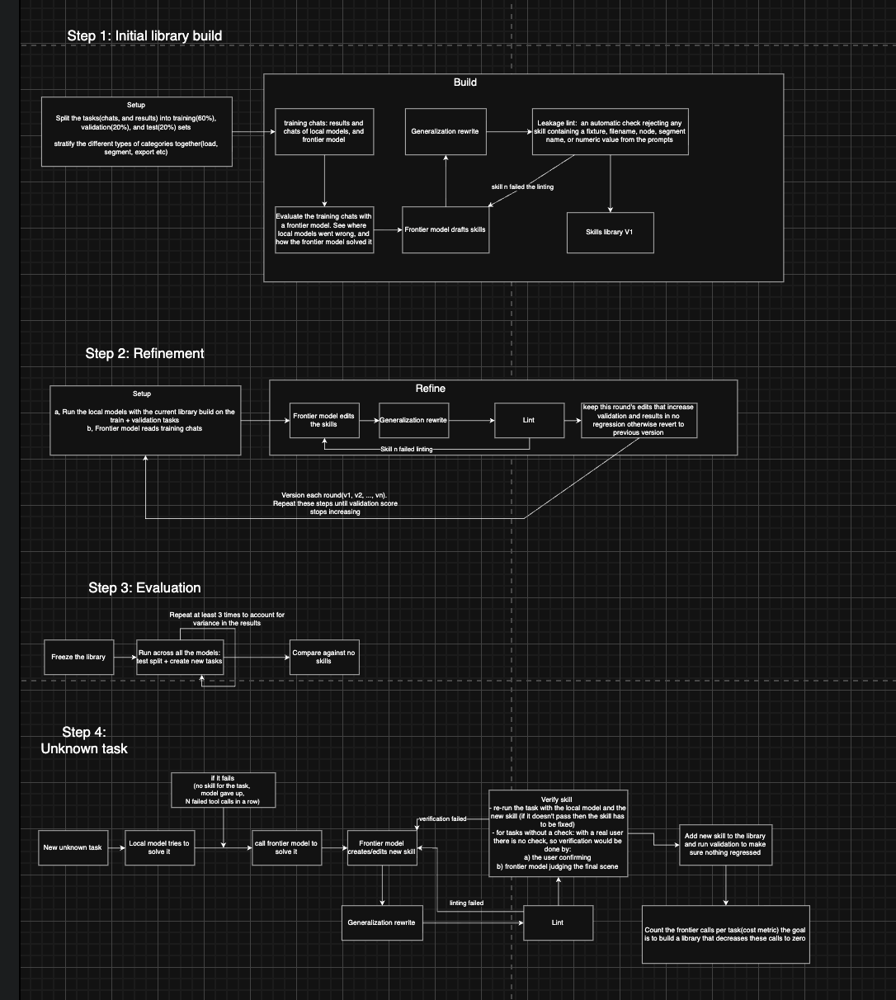

# Slicey-LocalLLM

A benchmark for how well local language models can drive [3D Slicer](https://www.slicer.org/) through the Slicey assistant. Each task is a natural-language prompt (e.g. "load this NRRD file"). The runner sends it to Slicey, waits for the model to finish, then checks the resulting Slicer scene automatically and records pass/fail.

The goal is to compare small local models against a frontier model on the same tasks, and then measure how much guidance techniques (code examples, recipes, error feedback) improve the local models. See [`docs/workplan.md`](docs/workplan.md) for the full plan.

## Setup

### Hardware

| | |
|---|---|
| Computer | 2025 MacBook Air, Apple M4 |
| Memory | 16 GB unified memory |

Slicer, the model server, macOS and the model all share the same 16 GB. The models were chosen to leave enough room for Slicer while they run. All data used is public sample data or small synthetic fixtures.

### Local model server: LM Studio

[LM Studio](https://lmstudio.ai/) serves the local models. It was chosen because:

- it gave the best performance of the local servers tried on this machine;
- it runs natively on Apple Silicon;
- it provides a local API server that Slicey connects to;
- it makes it easy to load models and see which model is serving requests.

Alternatives considered:

- **Docker Model Runner** uses `llama.cpp` with Metal on Apple Silicon. It's useful for container-based, repeatable setups.
- **vLLM** is the usual choice on Linux with an NVIDIA GPU. Its Apple Silicon support is experimental, so it isn't used here.

### Models

| Model | Role | Parameters | Size | Quantization | Max context |
|---|---|---:|---:|---|---:|
| `mistralai/Ministral-3` | local | 3B | 3.0 GB | Q4_K_M | 262,144 |
| `nvidia/nemotron-3-nano` | local | 4B | 2.8 GB | Q4_K_M | 1,048,576 |
| `qwen3-5-4b` | local | 4.3B | 2.8 GB | Q4 | 262,144 |
| `Llama-3.2-3B-Instruct` | local | 3.2B | ~2.0 GB | Q4_K_M | 131,072 |
| Claude Opus 5.5 (`claude-opus-5-5`) | frontier baseline | — | hosted | — | — |

Notes:

- All local models run with LM Studio's default inference settings.
- 8B and 12B models were too resource-intensive for this machine, and 2B models couldn't do even the most basic tasks. That leaves the 3–4B range.
- Llama 3.2 3B was trained partly on the outputs of Llama 3.1 8B and 70B (distillation). It's included as a small model that learned from a much larger one, and it adds a fourth model family (Mistral, NVIDIA, Qwen, Meta).
- The local models run through Slicey's `server` backend: Claude Code pointed at LM Studio's Anthropic-compatible API. So they get the same agent loop, tools and system prompt as Opus. Slicey asks for reasoning, so models that support it (e.g. Nemotron) run with reasoning on.
- The frontier model runs through Slicey's Claude Code backend, not LM Studio. It's selected as `Opus 5.5` in Slicey's model list, and it runs on a Claude Code subscription, so there's no per-token bill.

## Repository structure

```
Slicey-LocalLLM/
├── runner/
│   ├── run_benchmark.py   # runs on your machine: loads tasks, sends each to Slicer, saves results
│   └── slicer_worker.py   # runs inside Slicer: resets the scene, prompts Slicey, waits, runs the check
├── checks/
│   ├── checkManager.py    # finds the check for a task id and runs it (CheckContext helpers)
│   ├── checkLoad.py       # checks for the loading tasks (01–08)
│   └── test_files/        # fixtures the prompts refer to (see test_files/README.md)
│       └── outputs/       # where tasks write files; emptied before every task
├── tasks/
│   ├── task_prompts.md    # the task prompts, one "### <id> — <title>" section each
│   └── tasks.json         # JSON version of the tasks
├── tools/
│   └── json_converter.py  # converts task_prompts.md to JSON
├── docs/
│   ├── workplan.md        # setup, model selection and benchmark plan
│   ├── tasks.md           # the candidate tasks and their intended checks
│   └── images/            # diagrams used in this README
└── results/               # one folder per run (see "Run output" below)
```

### How a task runs

1. `run_benchmark.py` reads the prompts. It replaces `{TEST_FILES}` with the absolute path to `checks/test_files`, so the model gets a full path.
2. For each task, it POSTs a short Python snippet to Slicer's Web Server (`/slicer/exec`). The snippet runs `slicer_worker.py` inside Slicer.
3. The worker prepares a clean starting point, then sends the prompt:
   - clears the scene;
   - empties `outputs/`;
   - switches to a new, empty DICOM database. Your own database is reopened when the task ends;
   - sets Slicey's shared folders to `checks/test_files/outputs` (read-write) and `checks/test_files` (read-only). Slicey lists the shared folders in its system prompt, so every model gets the same prompt. `outputs/` has to be writable: when the export path was in a read-only folder, Opus refused to save there. Your own list is put back when the task ends;
   - resets Slicey's conversation and its session token counter;
   - selects the model;
   - sends the prompt through `logic.sendUserMessage`.
4. It waits for Slicey's `turn_finished` event, for up to 150 s. On a timeout it cancels the turn and waits for Slicey to become idle again.
5. The worker runs the task's check from `checks/` against the scene. If the turn finished, the check decides `passed`. After a timeout the task still counts as failed, but the check runs anyway, once the turn has been cancelled, and its result is recorded separately as `passed_at_timeout`.
6. The worker reads the task's token usage from Slicey's session counters.
7. The worker then saves the scene as an `.mrb` file and copies Slicey's chat log for the task into the run folder, and returns the result to the runner. This happens after the check, because saving a scene can change the file paths the checks read.
8. The runner adds timing and run info, then appends one line to the run's `results.jsonl`.

### Run output

Each run gets its own folder, named after the model and the start time. A `/` in the model name becomes `_`.

```
results/qwen3-5-4b_2026-11-14T15-02-11/
├── results.jsonl              # one line per task attempt
└── outputs/
    ├── task01_rep1_outp.mrb   # the scene the model left behind (open in Slicer: File → Load Scene)
    ├── task01_rep1_chat.md    # Slicey's chat log: the code the model ran, its errors and replies
    └── ...
```

The `.mrb` shows *what* the model produced, and the chat log shows *how* it got there. A scene is saved for every outcome except `worker_error`; for a timeout it's saved after the turn was cancelled. Each `.mrb` contains every file loaded into the scene, so runs add up quickly (about 7 MB for a task with MRHead).

### Result records

Each line of `results.jsonl` is one task attempt:

| Field | Meaning |
|---|---|
| `outcome` | `finished`, `timeout`, `slicey_error` (Slicey reported an error), `worker_error`, `request_error` or `code_error` (harness problems) |
| `passed` | `true` / `false` from the check; `null` if the task wasn't scored (no check, checker crashed, harness error) |
| `failures` | what the check found wrong, when `passed` is `false` |
| `passed_at_timeout`, `failures_at_timeout` | timeouts only: the check's result on the scene the model left behind. `passed` stays `false`, so `passed_at_timeout: true` means the work was right but the model didn't end its turn in time |
| `llm_s`, `wall_s` | time from prompt to end of turn, and total time for the task |
| `task_id`, `repeat`, `run_id`, `model`, `timestamp` | which attempt this was |
| `cancel_clean` | after a timeout: whether Slicey was idle again before the next task |
| `errors`, `checker_error` | error messages from Slicey or from the check, if any |
| `session_usage` | tokens the task used: `inputTokens`, `outputTokens`, `costUsd`, `costEstimateIncomplete` (see below) |
| `scene_file`, `chat_log` | the task's saved `.mrb` and chat log, relative to the run folder; `null` if saving failed |
| `scene_error`, `chat_log_error` | why saving the scene or copying the chat log failed (saving never changes the outcome) |

#### Token usage

`session_usage` comes from Slicey's session counters, which are reset at the start of every task, so the numbers cover that task only. They're read after the turn ends, and for a timeout after it has been cancelled.

- **Local models** (agent backend through LM Studio): Slicey counts tokens only when the agent reports the end of a turn. A cancelled turn still reports its usage, so timed-out tasks have real counts too.
- **Claude Opus** (Claude Code backend): Slicey records the token counts that Claude Code reports.
- **Cost:** `costUsd` is `0` for every model. Local models aren't billed per token, and Opus runs on a Claude Code subscription. To compare costs, estimate them from `inputTokens` and `outputTokens` and the API price.
- **Harness errors** (`request_error`, `code_error`, `worker_error`) have no `session_usage` field, because no model ran.

## Running the benchmark

### Prerequisites

1. **3D Slicer 5.13** with the **Slicey** extension installed.
2. **Slicer's Web Server module** running on port **2016**, with the Slicer API (`/slicer/exec`) enabled.
3. **For the local models:** LM Studio with its local server running and the model loaded. The model name must match the one in Slicey's model list.
   **For the Opus baseline:** Slicey connected to Claude Code, so `Opus 5.5` appears in Slicey's model list.
4. **Python 3** with `requests` (`pip install requests`) for the runner. The runner uses your normal Python, not Slicer's.

Check that Slicer's exec endpoint is reachable:

```bash
curl -X POST http://localhost:2016/slicer/exec --data '__execResult = {"hello": 1}'
# -> {"hello": 1}
```

### Run

```bash
python runner/run_benchmark.py                          # all tasks, default model
python runner/run_benchmark.py --tasks 01-08            # only tasks 01 to 08
python runner/run_benchmark.py --model nemotron-3-nano --tasks 01-08,11 --repeats 3
python runner/run_benchmark.py --model "Opus 5.5" --tasks 01-40   # frontier baseline
python runner/run_benchmark.py --help
```

| Option | Default | Meaning |
|---|---|---|
| `--model` | `qwen3-5-4b` | model name as shown in Slicey |
| `--file` | `task_prompts.md` | task file in `tasks/` (`.md` or `.json`) |
| `--tasks` | all | task ids, e.g. `01-08,11` |
| `--repeats` | `1` | run each task this many times |

All paths are worked out from the repo's own location, so you can run the runner from any folder. The run folder is printed at the start (`Run <model>_<timestamp> -> results/<model>_<timestamp>`). Each task is written to disk as soon as it finishes, so stopping with Ctrl+C keeps the results collected so far.

### Testing checks without a model

A check should fail on an empty scene and pass on a correct one. To test this, set up both by hand in Slicer's Python console and call the check directly:

```python
import runpy
run_check = runpy.run_path("<repo>/checks/checkManager.py")["run_check"]
slicer.mrmlScene.Clear(0)
print(run_check("01"))   # empty scene -> passed: False
```

## Phase 2: Skills library (planned)

The baselines show what local models get wrong. Phase 2 tries to fix that with a **skills library**: short, reusable instructions written by the frontier model and given to the local models. A skill is a recipe for using Slicer, for example "save a node with `slicer.util.saveNode(node, path)` and check the return value". It isn't the answer to a specific task.

The goal is a library that lets local models solve most tasks on their own. When they meet something new, they call the frontier model once, and the answer becomes a new skill. The main risk is **overfitting**: skills that only work on the benchmark tasks they were written from. Most of the design below exists to prevent and detect that.



### Step 1: Initial library build

- **Split the tasks:**
  - training 60%, validation 20%, test 20%;
  - split by task id, so every run of a task stays in the same set;
  - stratify, so each set contains every category (load, segment, export, …).

  The split is fixed once and never redrawn. Redrawing would let every task gradually shape the library.
- **Evaluate the training chats.** The frontier model reads the local models' failed chats next to Opus's successful ones for the same tasks. It sees where the local models went wrong (made-up APIs, path typos, faked outputs) and how the task should be done. It doesn't see the check code.
- **Draft skills** from those findings.
- **Generalization rewrite.** The frontier model rewrites each draft so it describes the general technique, not the task it came from. For example, "threshold Bone 300–800 in Benchmark CT" becomes "create a segment from a threshold range with …".
- **Leakage lint.** An automatic check that rejects any skill containing a fixture file name, node or segment name, or numeric value from the task prompts. It catches what the rewrite missed, and it runs after the rewrite because the rewrite could reintroduce such details. A rejected skill goes back to drafting.
- The skills that pass make up **library v1**.

### Step 2: Refinement

Each round:
1. Run the local models with the current library on the training and validation tasks.
2. The frontier model reads **only the training chats** and edits the skills. Validation tasks contribute their scores, never their chats. That way the validation score stays an honest measure of generalization.
3. Rewrite and lint the edited skills, as in Step 1.
4. **Gate:** keep the round's edits only if the validation score goes up and no task that passed before now fails. Otherwise revert to the previous version. The round's edits are judged together, because skills affect each other.

Each kept round is a new library version (v1, v2, …). Every run records which version it used. Stop when the validation score stops improving.

### Step 3: Evaluation

- Freeze the library. From here on, nothing changes it.
- Run every model on:
  - the test split, which hasn't influenced the library at all;
  - **new tasks written after the freeze**, so they can't have been designed around the skills.
- Run each task at least 3 times. Local models vary a lot between runs, so report the average and the spread, not a single result.
- Compare against the same runs **without skills**, and preferably also with generic Slicer documentation of the same length. That shows whether the skills help, or just any extra context does.
- Report results separately for models whose chats were used to build the library and for models that weren't. The second group shows whether the skills transfer to other models.

### Step 4: Unknown tasks

This is how the library is meant to keep growing in use:

1. The local model tries the task with the library.
2. If it fails, it calls the frontier model to solve it. "Fails" means one of: no matching skill, the model gives up, or N failed tool calls in a row.
3. The frontier model writes a new skill (or edits an existing one). The skill goes through the generalization rewrite and the lint.
4. **Verify the skill.** The **local model** re-runs the task with the new skill. The frontier model passing the task isn't enough: the skill has to be usable by a small model. If it fails, the skill goes back to the frontier model. Benchmark tasks are verified by their check. Real tasks have no check, so verification is the user confirming, or the frontier model judging the final scene.
5. Add the skill to the library, and run the validation tasks once to make sure nothing regressed.

Count the frontier calls per task. That's the cost metric: as the library grows, it should fall toward zero.

### Code structure (planned)

Slicey has a **Custom instructions** setting, which it appends to the system prompt. The worker puts the skills there for each task, the same way it sets the shared folders. So Phase 2 doesn't need any changes to Slicey.

```
Slicey-LocalLLM/
├── runner/
│   ├── run_benchmark.py   # + --skills, --split
│   └── slicer_worker.py   # + sets skills as custom instr.
├── skills/
│   ├── splits.json        # frozen task split
│   ├── library/           # one .md per skill
│   │   └── save-node.md
│   └── prompts/           # frontier prompts per step
│       ├── evaluate.md
│       ├── draft.md
│       ├── rewrite.md
│       └── edit.md
└── pipeline/
    ├── split.py           # Step 1 setup
    ├── library.py         # load, render, token count
    ├── frontier.py        # calls claude -p
    ├── lint.py            # leakage lint
    ├── build.py           # Step 1
    ├── refine.py          # Step 2 loop
    ├── gate.py            # keep or revert
    ├── evaluate.py        # Step 3
    ├── metrics.py         # pass rates, spread, etc.
    └── escalate.py        # Step 4 prototype
```

**Runner changes**

| File | Change |
|---|---|
| `run_benchmark.py` | `--skills <library path \| none>` picks the library for the run. `--split train\|val\|test` runs only that split's tasks. Every result records the library version and its token count. |
| `slicer_worker.py` | Puts the rendered library into Slicey's custom instructions before the prompt, and restores your own instructions afterwards. |

**`skills/`: data**

| Path | Contents |
|---|---|
| `splits.json` | Which task ids are in training, validation and test. Written once by `split.py` and never changed afterwards. |
| `library/` | The skills, one Markdown file each. A short header gives the `name`, a one-line `description`, the `category` and the training tasks it came from (`sources`). The body is the recipe itself. The library is versioned with git tags (`skills-v1`, `skills-v2`, …), so any result can be traced back to the exact library it ran with. |
| `prompts/` | The instructions given to the frontier model at each step: evaluate the chats, draft skills, rewrite them in general terms, edit them in refinement. Keeping them as files means they're versioned and can be reviewed like the skills. |

**`pipeline/`: the steps**

| File | What it does |
|---|---|
| `split.py` | Makes the stratified 60/20/20 split by task id and category, and writes `splits.json`. |
| `library.py` | Loads and saves skill files. Renders the library into the text that goes into the system prompt, and reports its token count and git version. Small models degrade with long prompts, so the token count is recorded with every result. |
| `frontier.py` | The only place that calls the frontier model. It uses `claude -p` (Claude Code without the interactive session), so the calls run on the Claude Code subscription like the Opus baseline. Switching to the API would only change this file. |
| `lint.py` | The leakage lint. It builds the forbidden list automatically: names and numbers from `task_prompts.md`, file names in `checks/test_files`, and node and segment names from the checks. A skill containing any of them is rejected, and the result says which string matched. A small allowlist covers general values, such as `-1000` for air in CT. |
| `build.py` | Step 1. Collects the training chats and results, then runs: evaluate, draft, rewrite, lint. The skills that pass are saved as v1. It reads `splits.json`, so it can't pass validation or test chats to the frontier model by accident. |
| `refine.py` | The Step 2 loop. Each round: run the benchmark on training and validation tasks, have the frontier model edit the skills from the training chats, rewrite and lint them, run again, and ask `gate.py` whether to keep the edits. A kept round is committed and tagged as the next version. A rejected one is reverted. Stops when the validation score stops improving. |
| `gate.py` | Compares two runs task by task. Returns keep or revert, and lists any task that passed before and now fails. |
| `evaluate.py` | Step 3. Runs every model on the test split and the new tasks, with no skills, with generic docs and with the frozen library, each at least 3 times. |
| `metrics.py` | Summarises results: pass rate as average and spread over repeats, tool-call success rate, faked outputs, frontier calls per task. |
| `escalate.py` | A prototype of Step 4 in the harness: when a task fails, the frontier model writes a skill, then the rewrite, lint, re-run with the local model, and a validation run. A real version has to work inside Slicey during the turn, which would need changes to Slicey. |

To start with, the whole library goes into the prompt. If it gets too long for the small models, the alternative is retrieval: the library sits in a read-only shared folder, the prompt carries only an index of skill names and descriptions, and the model opens the skills it needs with `read_text_file`.
